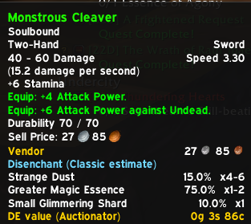
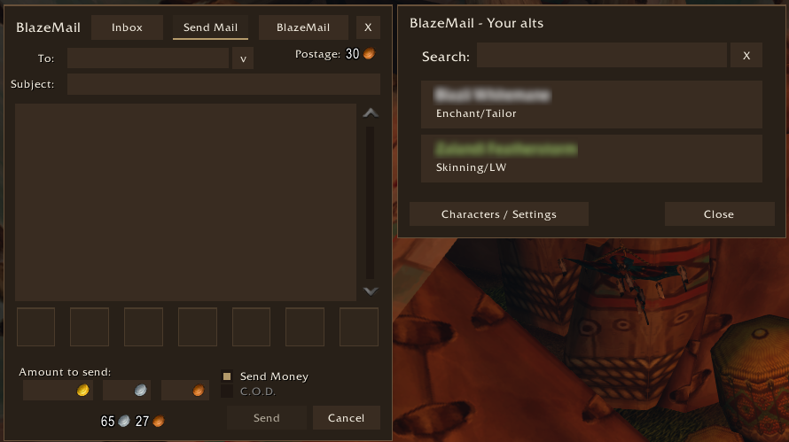
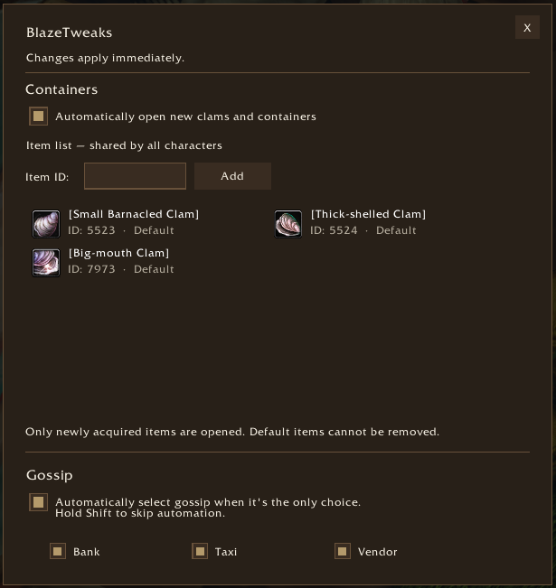

# WoW AddOns

This repository contains small, independent World of Warcraft addons developed for WoW Forever. Each addon addresses a specific need that existing addons did not meet.

Each addon lives in its own directory and can be installed separately.

## Addons

- [BlazeDisenchant](./BlazeDisenchant/) shows which materials an item may yield when disenchanted, using Classic drop estimates. It also logs actual disenchant results in WoW Forever. With Auctionator price data, the tooltip includes the estimated value of the materials.

  Open the observation log with `/bde` or `/blazedisenchant`.

  

- [BlazeMail](./BlazeMail/) adds a searchable recipient picker to the Send Mail window. Select an alt to fill in the recipient field. In **Characters / Settings**, you can choose a theme, mark individual characters as favorites, and add notes for each character.

  Open **Characters / Settings** with `/bm` or `/blazemail`, or click the **BlazeMail** button in the mailbox window.

  **Send Mail with the BlazeMail theme**

  

  **Send Mail with the Blizzard theme**

  

  **Characters / Settings**

  

- [BlazeTweaks](./BlazeTweaks/) adds two independent options. One automatically opens newly acquired clams and other containers on a configurable list. The other automatically selects eligible NPC dialogue options. Hold Shift when talking to an NPC to choose manually.

  **Settings** — open with `/bt` or `/blazetweaks` to configure automatic containers, the shared item list and Bank, Taxi and Vendor dialogue choices.

  
