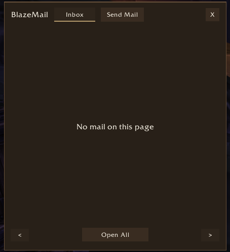
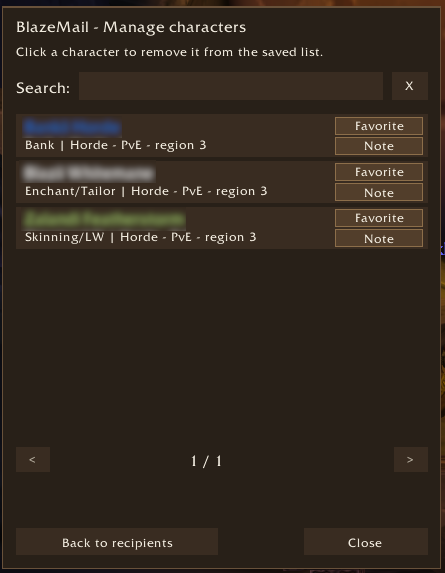

# WoW AddOns

This repository contains small, independent World of Warcraft addons developed for WoW Forever. Each addon addresses a specific need that existing addons did not meet.

Each addon lives in its own directory and can be installed separately.

## Addons

- [BlazeDisenchant](./BlazeDisenchant/) shows which materials an item may yield when disenchanted, using Classic drop estimates. It also logs actual disenchant results in WoW Forever. With Auctionator price data, the tooltip includes the estimated value of the materials.

  

- [BlazeMail](./BlazeMail/) restyles the mailbox and adds a searchable recipient picker to the send-mail window. Select one of your alts to fill in the recipient field without typing the character's name.

  **Inbox** — the restyled mailbox.

  

  **Send Mail and recipient picker** — find an alt by name and select a recipient.

  

  **Manage characters** — search saved characters, mark favorites and add notes.

  

- [BlazeTweaks](./BlazeTweaks/) adds two independent options. One automatically opens newly acquired clams and other containers on a configurable list. The other automatically selects eligible NPC dialogue options. Hold Shift when talking to an NPC to choose manually.

  **Settings** — configure automatic containers, the shared item list and Bank, Taxi and Vendor dialogue choices.

  
